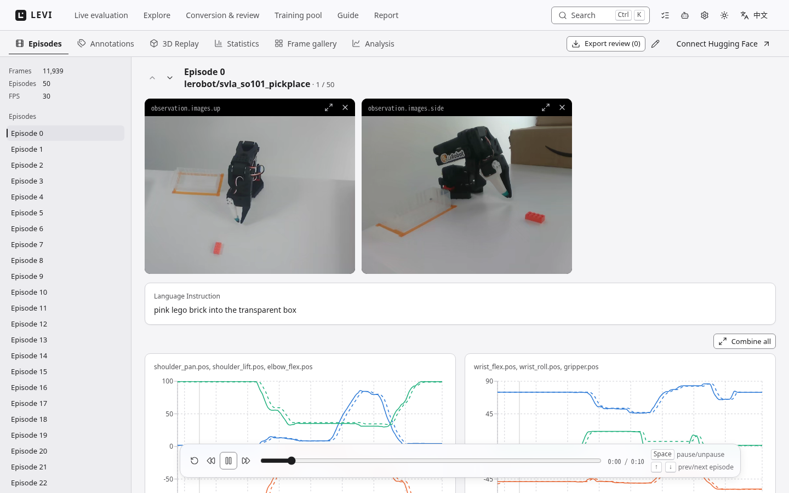
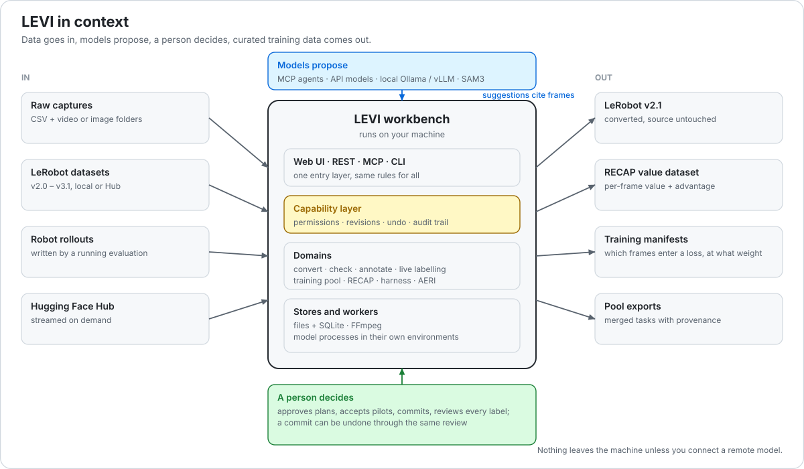
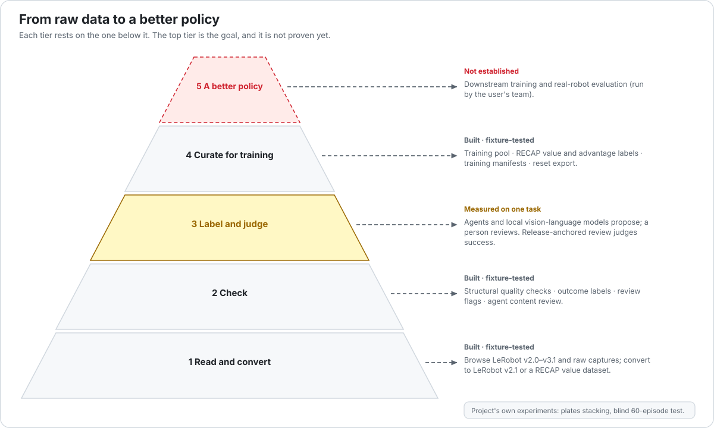
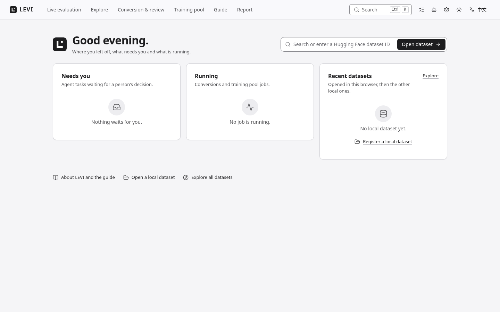

# LEVI · Robot Data Atelier

**LeRobot Exploration, Validation & Integration**

> Look at your robot data again before it trains the next policy: a model proposes, a person decides, and every step is measured.

[](https://github.com/Koooki3/LEVI/actions/workflows/test.yml) [](LICENSE) [](CHANGELOG.md)

English · [简体中文](README.zh-CN.md)

LEVI is a local workbench for robot-learning data. It browses LeRobot datasets and raw robot captures, converts them into training formats, checks their quality, and labels them with AI agents and local vision-language models; a person reviews every suggestion before it is published (the one exception is the live service's audited auto-approver, described below). It runs on your machine: source data is never modified, and nothing leaves the machine unless you connect a remote model.

<picture>
  <source media="(prefers-color-scheme: dark)" srcset="docs/assets/ui-viewer-en-dark.png">
  
</picture>

A robot policy is only as good as the data it learns from, and the data is full of episodes that failed, drifted or were mislabelled. LEVI answers one question: **with limited compute, human review and robot time, what should be done with robot data so that the next policy gets better?** It inspects data again, repairs labels, changes how data enters training, and keeps a measured record of what each step cost and whether it helped.

## Architecture at a glance

<picture>
  <source media="(prefers-color-scheme: dark)" srcset="docs/assets/atlas/01-system-context-dark.svg">
  
</picture>

<picture>
  <source media="(prefers-color-scheme: dark)" srcset="docs/assets/atlas/02-pyramid-dark.svg">
  
</picture>

Five more figures (layers, a task step by step, live annotation beside a robot, the automatic evaluation authority split, and the evidence with its limits) are in the [architecture atlas](docs/ARCHITECTURE.md).

## What is new

- **Release-anchored review.** It judges success at the moments the robot's own signals mark (each gripper opening), one narrow question per event. On the plates task it raised balanced accuracy from 0.81 to 0.94 ([measured](#what-has-been-measured)).
- **One capability layer.** The web UI, REST, MCP and the CLI share it: a model's suggestion becomes a label only through a person's commit, and a commit can be undone ([layers](docs/ARCHITECTURE.md#3-layers-of-the-workbench)).
- **Every run is costed.** Tokens and time are recorded per agent and per dataset, and a memory of what a person verified starts the next task ([agents](docs/AGENTS.md)).
- **Labelling beside a running robot.** The live service shares one GPU with the policy server and yields when the policy infers ([figure](docs/ARCHITECTURE.md#5-live-annotation-beside-a-robot)).
- **Authority split for automatic evaluation.** One part alone may command the robot and write the journal, and the contract refuses robot or reset commands from the judge and the runtime. Software with fake-I/O validation; hardware acceptance is pending ([figure](docs/ARCHITECTURE.md#6-automatic-evaluation-three-parts-one-authority)).
- **Honest evidence.** The negative results stay in view: the second task missed the bar, and whether curated data improves a policy is not established ([evidence](docs/ARCHITECTURE.md#7-evidence-with-its-limits)). The live **Report** page keeps the numbers current.

## What it does

| | |
| --- | --- |
| **Browse and analyze** | Synchronized multi-camera playback, state/action charts, statistics, a frame gallery, Action Insights and 3D robot replay for LeRobot v2.0–v3.1, local or on the Hugging Face Hub. Derived from the [LeRobot Dataset Visualizer](https://github.com/huggingface/lerobot-dataset-visualizer). |
| **Convert** | Raw captures (CSV + video or image folders) and LeRobot v2.x into **LeRobot v2.1** or a **RECAP (π\*0.6) value dataset**, after an inspection that lists which requirements the input meets. |
| **Check and curate** | Structural quality checks, outcome labels, review flags, agent-driven content review, and a **release-anchored review** that judges success at the moments the robot's own signals mark (such as each gripper opening), one narrow question per event. |
| **Annotate with agents** | Time segments, events and object masks proposed by an external MCP agent (Claude Code, Codex, …), an API model or a **local model** (Ollama or vLLM), then reviewed, committed and undoable by a person. |
| **Label live evaluations** | A background service labels policy rollouts while a robot evaluation is still writing them, and yields the GPU to the policy ([below](#live-annotation-of-robot-evaluations)). |
| **Training pool** | Index every dataset under the read-only folders named in `LEVI_POOL_ROOTS` per episode, group copies, hold out frozen test episodes, compose tasks in order and export a merged LeRobot v2.1, RECAP value or raw-capture dataset with a provenance record. |
| **Segment objects fast** | A small student model distilled from SAM3 outlines and tracks objects while an episode plays and labels whole datasets offline; results stay `suggested` until a person reviews them. |
| **Feed training** | A RECAP value model gives per-frame values and advantage labels; training manifests state which frames enter a learner's loss and with what weight. |
| **Learn from every task** | The harness closes each task with a ledger, the measured token and time cost, a memory of what was verified on that dataset, and improvement candidates a person can publish. |

## What has been measured

The numbers below come from the project's own experiments on one task family (plates stacking) unless stated otherwise; they come from the project's own experiment record, which is not shipped in this repository; [Validation](docs/VALIDATION.md) documents the anchored-review re-run.

- **Judging success is the clear gain.** Release-anchored review raised balanced accuracy on a blind 60-episode test set from 0.81 to 0.94 and cut "failure judged as success" from 38.5% to 12.8%, without missing a real success.
- **Time-segment labelling is at parity.** LEVI and a direct call of the same local model score alike against blind gold labels (segment F1 about 0.34). LEVI takes about 1.7× the direct call's wall time (development set, candidate configuration; 3.6× before the speed-up).
- **A second task did not meet the bar.** On the second task (screws) anchored review reached a balanced accuracy of 0.76, with 49% of failures judged successes; the quality gate for scaling up is not met.
- **Not established:** whether training on LEVI-curated data improves a robot policy. A downstream training experiment is under way; there is no result yet.

## Quick start

Requires [uv](https://docs.astral.sh/uv/getting-started/installation/) and FFmpeg (`sudo apt install ffmpeg` or `brew install ffmpeg`). Linux x86_64 is tested; macOS works; use WSL2 on Windows. `uv run levi install --profile core` does the steps below in one go and `uv run levi doctor` checks the machine. The full guide, optional parts, running LEVI as a service and the command reference: [INSTALL.md](INSTALL.md) ([中文](INSTALL.zh-CN.md)); an AI agent installing LEVI follows [INSTALL.agent.md](INSTALL.agent.md).

```bash
git clone https://github.com/Koooki3/LEVI.git
cd LEVI
export LEVI_WORKSPACE="$PWD/.state"          # where datasets and LEVI's state live
export UV_CACHE_DIR="$LEVI_WORKSPACE/.cache/uv"
export UV_PYTHON_INSTALL_DIR="$PWD/.runtime/python"
cp .env.example .env
uv sync --locked --extra agent
uv run levi setup                             # checksum-verified Bun + frontend dependencies
uv run levi build
uv run levi                                   # starts the Web UI and the API
```

Wait for **Ready** and open **http://127.0.0.1:7860** (7861 is the internal API, not the workbench). **Explore** lists two public LeRobot datasets that stream on demand ([svla_so101_pickplace](https://huggingface.co/datasets/lerobot/svla_so101_pickplace), [aloha_static_coffee](https://huggingface.co/datasets/lerobot/aloha_static_coffee)); put your own datasets or raw captures under `$LEVI_WORKSPACE` and they are registered automatically. Ctrl+C stops both services. On a remote server forward the port: `ssh -L 7860:127.0.0.1:7860 user@server`. For a strict CPU-only session set `export LEVI_CPU_ONLY=1` before starting: it disables the background GPU watcher and blocks local accelerator-backed inference, SAM3, fast segmentation and RECAP value models.

Day to day: `uv run levi stop` (refuses while jobs run), `uv run levi clean` (previews regenerable caches), `uv run levi docs check`; every other command and its `--help` is listed in the [INSTALL command reference](INSTALL.md#7-command-reference).

## The interface

The LEVI mark opens **Home** (what needs you, what is running); the header opens **Live evaluation**, **Explore**, **Conversion & review**, **Training pool**, **Guide** and **Report**, plus Jobs, the **Agent Workbench**, settings, theme and language. `Ctrl+K` (⌘K on macOS) opens the command palette (pages, datasets, actions); `G` then `H`, `E`, `W`, `P`, `L`, `R` or `U` jumps to a page; `?` lists the shortcuts. Light or dark, system fonts only, reduced-motion setting ([Design system](docs/DESIGN.md)).

<picture>
  <source media="(prefers-color-scheme: dark)" srcset="docs/assets/ui-home-en-dark.png">
  
</picture>

## Live annotation of robot evaluations

`levi live` is a separate background LEVI with its own workspace. It watches the folders a robot evaluation writes and labels each finished episode with a local model (Qwen3.8 on vLLM): time segments, segment outcomes and a whole-episode success verdict. It never writes the rollout folders, connects to the robot or writes human outcome labels; its verdicts are automatic and unreviewed everywhere they appear, and you review them in the normal viewer. `--auto-approve` lets the service's audited automatic approver commit the time segments of its own runs, in its own workspace only, marked `auto`; without it each batch waits for a person at up to three gates. It shares one GPU with the robot's policy server (a gate keeps the model idle while the policy infers, vLLM sleeps when idle; start it before the policy server) and needs the vLLM environment and weights (`uv run levi install --profile live`) and an NVIDIA GPU with room beside the policy. The **Live evaluation** page shows progress. Commands (`levi live init`, `doctor`, `start --daemon --auto-approve --prewarm`, `status`, `stop`), settings, GPU rules and the audit trail: [Live annotation service](docs/LIVE.md) ([中文](docs/LIVE.zh-CN.md)), [vLLM](docs/VLLM.md).

## Agents, with a person in charge

An agent reads sampled evidence and proposes; only a person approves a plan, accepts a pilot and commits (the live service's auto-approver above is the one exception). One capability layer, shared by the web UI, REST, MCP and the CLI, enforces the boundary. Every suggestion cites the frames it was read from, uncertainty is a valid answer, and a commit can be undone through the same review.

| Channel | Model | Set up with |
| --- | --- | --- |
| External MCP | Your own agent (Claude Code, Codex, any MCP client) | `uv run levi agent connect --client claude --project <dir> --dataset local/<name> --apply` |
| Online | An OpenAI-compatible endpoint, metered by LEVI | Agent Workbench → Accounts & connections |
| Local | An Ollama model on this machine (default `qwen3.5:4b`) or a local vLLM server, metered, no API key | [Local models](docs/OLLAMA.md), [vLLM](docs/VLLM.md) |
| Managed Pilot | A Codex or Claude Code session LEVI supervises | [Pilot](docs/PILOT.md) |

A task goes **plan → approve → pilot → review pilot → remaining episodes → review → commit**; LEVI checks the spec against the catalog and waits for your approval before anything runs. With a local model one sentence can start it:

```bash
uv run levi agent task new "Check the quality of <dataset>, then annotate subtasks on the first 10 demos and report tokens and time" --provider qwen-local
```

Around every task the **harness** records tokens and time per agent and per dataset, keeps a memory of human-verified facts that the next task starts from, and files improvement candidates you can evaluate and publish. See [Agents](docs/AGENTS.md) and [Anchored review](docs/ANCHORED_REVIEW.md).

## Documentation

Start with [Install](INSTALL.md), the [architecture atlas](docs/ARCHITECTURE.md), [Workspace](docs/WORKSPACE.md), [Agents](docs/AGENTS.md), [Live annotation](docs/LIVE.md), [Training pool](docs/TRAINING_POOL.md), [API](docs/API.md) and [Validation](docs/VALIDATION.md). The full index, with every data, agent, model, labelling-method and reference guide, is [docs/README.md](docs/README.md) (中文: [docs/README.zh-CN.md](docs/README.zh-CN.md)). The **Report** page shows a live technical report from a folder you name with `LEVI_REPORT_DIR` (read-only, may be outside the workspace); see [API](docs/API.md#technical-report--技术报告).

## Workspace, security and deployment

`LEVI_WORKSPACE` holds data and state and can live outside the checkout (default `.state/`): datasets directly under it, LEVI's own state under `outputs/LEVI/`, model weights under `checkpoints/`. LEVI follows the workspace while it runs (datasets copied in are registered, changed ones refreshed, removed ones dropped). A **namespace** (`uv run levi namespace create <dataset> <name>`) lets several experiments share one source dataset without copying it; to share one GPU with other tools, set `LEVI_GPU_LOCK_FILE` to a lock file they also honour. DROID raw folders are a browse-and-annotate input, not a supported training conversion, and the optional DROID test sample (about 11.6 GiB) is downloaded only when you run `levi sample fetch droid` or set `LEVI_DROID_SAMPLE=on`. See [Workspace](docs/WORKSPACE.md) and [Conversion](docs/CONVERSION.md#droid-raw-browsing-view).

LEVI is a single-user local workbench with file access; Hugging Face sign-in controls Hub access, not LEVI permissions. Never commit credentials or `.env`. Put any shared deployment behind an authenticated reverse proxy, set `LEVI_SECURE_COOKIES=1` for HTTPS or Space embeds, and list its host name or LAN address in `LEVI_UI_ALLOWED_HOSTS`, e.g. `LEVI_UI_ALLOWED_HOSTS=levi.example.org` (the page answers `127.0.0.1`, `localhost` and `[::1]` on any port; changes are accepted only from LEVI's own page, so scripts use the `levi` CLI). This guards against other web pages, not against programs on this machine ([Trust boundary](docs/API.md#trust-boundary-of-the-web-bridge--网页桥接的信任边界)). Hub upload is an explicit API action; conversion and saving never upload.

```bash
docker build -t levi:local .
docker run --rm -p 127.0.0.1:7860:7860 -v "$HOME/levi-data:/workspace" levi:local
```

Mapping another local port (`-p 127.0.0.1:8080:7860`) works as is; publishing on a LAN address or name needs `-e LEVI_UI_ALLOWED_HOSTS=<name>`. The image installs the core only and has not been built or run.

## Status and limits

The current release is **0.3.0**; `main` carries unreleased work listed in the [changelog](CHANGELOG.md): the agent harness and local models, release-anchored review, the live annotation service, fast instance segmentation, RECAP value labels, training manifests, the training pool, the redesigned interface and the report page.

- **Evidence is sampled.** Dense refinement looks where it is pointed and cannot prove that nothing happened elsewhere.
- **Quality is measured per dataset, not claimed.** Automated tests use fixtures and stub models. The anchored-review rules are validated on one task (plates) and did not generalise to the second task (screws) at the quality bar; the fast segmentation student is scored against SAM3's labels, not human labels; automatic live verdicts are unreviewed and over-call success on tasks that place several objects. Whether curated inputs improve a trained policy is not established here.
- **Not built.** MCP is stdio only. There is no multi-user access control, no OS-level offline sandbox and no GPU scheduler: the GPU guardian, the live gate and `LEVI_GPU_LOCK_FILE` are courtesy policies among cooperating processes.
- **Known gap.** With `--ui`, if the live service's core process dies while its page process lives, the supervisor does not notice yet; restart the service.
- **Not verified.** The Docker image has not been built or run.

Details: [Validation](docs/VALIDATION.md).

## Troubleshooting

- **`{"detail":"Not Found"}` or the API landing page** — you reached port 7861; open 7860 and check that your SSH or editor port forwarding targets server port 7860.
- **A local path is refused** — it must be a LeRobot dataset (`meta/info.json`) or a recognised raw capture (`task/demo_NNNN` or a DROID `demo_NNNN/trajectory.h5`), and its real path must be inside `LEVI_WORKSPACE`.
- **A conversion fails** — read the inspection checklist and the job log; duplicate or missing frame ids, unknown gripper commands or video count mismatches stop it before anything is published, and the source is never modified.
- **A local-model run is blocked** — the reason names the process using the GPU; the run resumes once the GPU has been free for `LEVI_GPU_QUIET_SECONDS`.
- **A SAM3, segmentation or RECAP action says the worker is missing** — each model runs in its own environment (`integrations/sam3`, `integrations/segmentation`, `integrations/recap_value`, each with its own `setup.sh` or README); the core never imports Torch. See [SAM3](docs/SAM3.md), [Fast segmentation](docs/SEGMENTATION.md), [RECAP](docs/RECAP.md).
- **Interrupted after a restart** — jobs are marked interrupted and never resume writing on their own; plan again.

## Development and citing

```bash
uv sync --locked --group dev --extra agent
uv run levi check                                 # frontend validation, Ruff, docs check
mkdir -p "$LEVI_WORKSPACE/tmp/build"
uv run pytest --basetemp="$LEVI_WORKSPACE/tmp/build/pytest"
export PATH="$(ls -d "$PWD"/.runtime/bun-*):$PATH"   # the Bun that `levi setup` installed
bun run format && bun run validate                # type check, lint, format, frontend tests
uv run levi build
```

`uv run levi docs sync` regenerates the generated doc sections; CI runs the same checks and a production build. Read [CONTRIBUTING](CONTRIBUTING.md) before submitting changes and report problems in [Issues](https://github.com/Koooki3/LEVI/issues). LEVI is licensed under Apache-2.0 and keeps the upstream `LICENSE`, `NOTICE` and [attribution](docs/UPSTREAM.md) ([third-party notices](THIRD_PARTY_NOTICES.md)). If LEVI helps your work, please cite it: GitHub's "Cite this repository" button reads [`CITATION.cff`](CITATION.cff), and [docs/REFERENCES.md](docs/REFERENCES.md) has a BibTeX entry plus the works LEVI builds on (LeRobot, SAM 3, RF-DETR, RECAP/π\*0.6, openpi, vLLM, CAST, DROID and others), their licences and how to cite them. Cite the version you used (`v0.3.0`; later changes are under "Unreleased" in the [changelog](CHANGELOG.md)).
