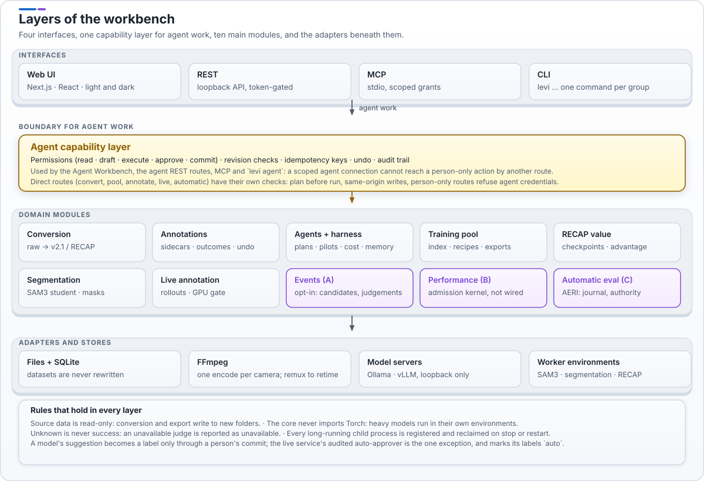
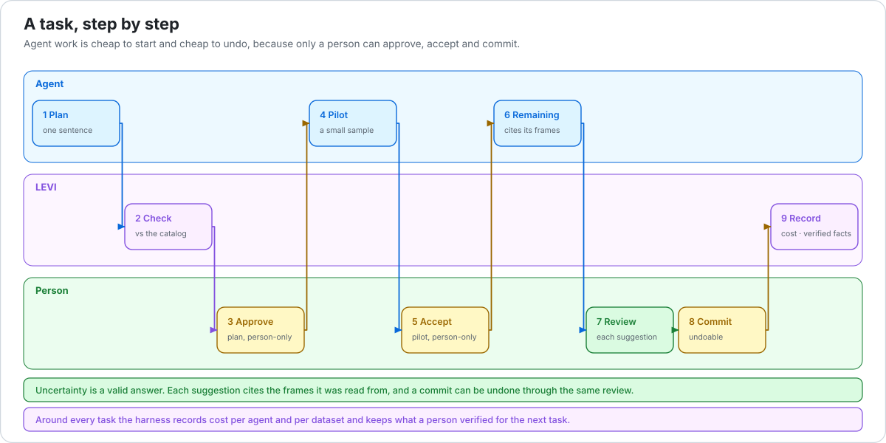
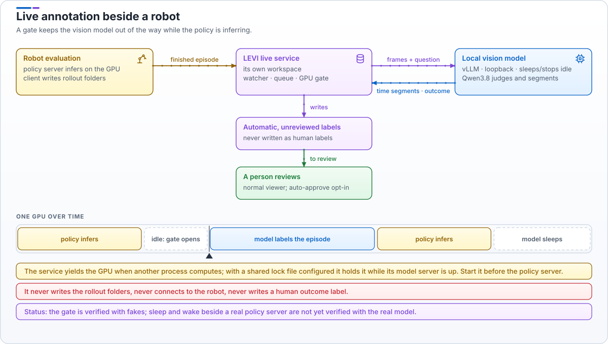
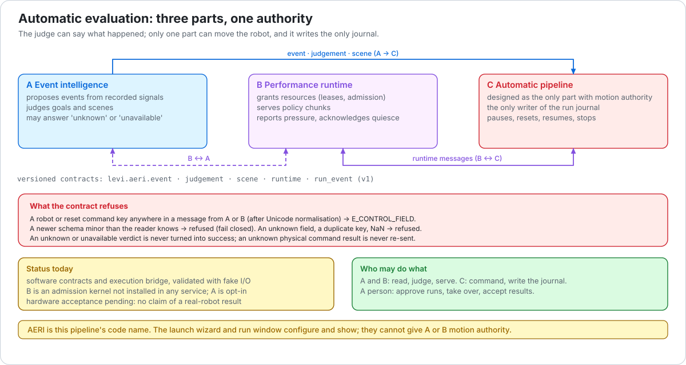
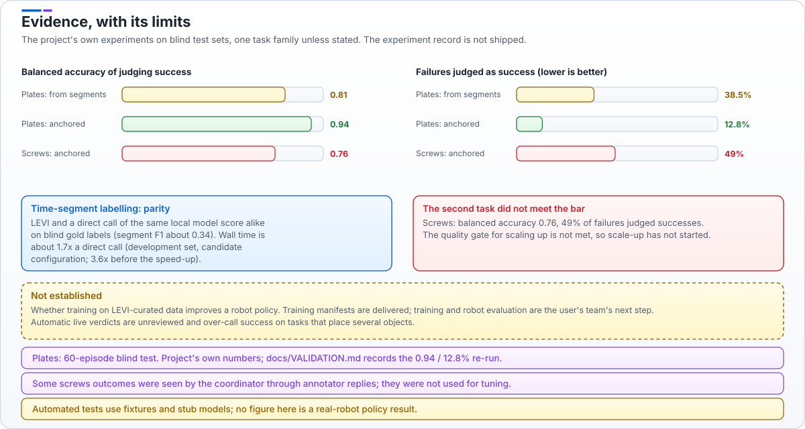

# Architecture atlas

Seven figures that let a newcomer see how LEVI is built and what it has shown, in the order a reader usually asks: where it sits, what it is for, how it is layered, how a task runs, how it shares a GPU with a robot, who may move the robot, and what the evidence is. English only, because the labels are part of the drawing. Each figure has a light and a dark file; the page picks the one that matches your theme.

The figures are generated from [`docs/atlas/build.py`](atlas/build.py), plain SVG with no script and no external image, so they diff as text and render the same on GitHub and in a browser. A test regenerates them and fails when a committed file is out of date. Edit the script, run `python3 docs/atlas/build.py`, commit the result.

## 1 LEVI in context

<picture>
  <source media="(prefers-color-scheme: dark)" srcset="assets/atlas/01-system-context-dark.svg">
  
</picture>

*Read it left to right.* Everything inside the frame runs on your machine. The entry layer (web UI, REST, MCP, CLI) goes through one capability layer, so the rules are the same whichever door an agent or a person uses. Models only propose; a person approves and commits. Source data is never modified.

## 2 From raw data to a better policy

<picture>
  <source media="(prefers-color-scheme: dark)" srcset="assets/atlas/02-pyramid-dark.svg">
  
</picture>

*Read it bottom to top.* Each tier depends on the one below it. The measured result sits at tier 3 (judging success on one task); the top tier is the goal and has no result yet. [Evidence](#7-evidence-with-its-limits) shows the numbers.

## 3 Layers of the workbench

<picture>
  <source media="(prefers-color-scheme: dark)" srcset="assets/atlas/03-layers-dark.svg">
  
</picture>

*Read it top to bottom.* The yellow band is the boundary that matters: permissions, revision checks, idempotency and undo live there, once. The purple modules (events, performance, automatic evaluation) are the three parts of the automatic evaluation pipeline, shown in figure 6. Heavy models run in their own environments and the core never imports Torch.

## 4 A task, step by step

<picture>
  <source media="(prefers-color-scheme: dark)" srcset="assets/atlas/04-human-in-charge-dark.svg">
  
</picture>

*Read it left to right, lane by lane.* The yellow steps are the gates only a person can pass. An agent can do most of the work, but cannot approve, accept or commit, which is why its work is cheap to start and cheap to undo. [Agents](AGENTS.md) documents every capability behind these steps.

## 5 Live annotation beside a robot

<picture>
  <source media="(prefers-color-scheme: dark)" srcset="assets/atlas/05-live-gpu-dark.svg">
  
</picture>

*Read the top as data flow and the strip as time.* One GPU is shared by turns: the gate keeps the model out of the way while the policy infers, and the model sleeps when idle. The service never writes the rollout folders and never writes a human label. [Live annotation service](LIVE.md).

## 6 Automatic evaluation: three parts, one authority

<picture>
  <source media="(prefers-color-scheme: dark)" srcset="assets/atlas/06-aeri-authority-dark.svg">
  
</picture>

*Read the red box as the point of the design.* A and B can say what happened and what resources exist; they cannot carry a robot or reset command, and the contract refuses a message that does. Only C commands motion and writes the journal. **This pipeline is validated with fake I/O; hardware acceptance is pending.** [Automatic evaluation pipeline](AUTOMATIC_PIPELINE.md), [Event intelligence](EVENTS.md).

## 7 Evidence, with its limits

<picture>
  <source media="(prefers-color-scheme: dark)" srcset="assets/atlas/07-evidence-dark.svg">
  
</picture>

*Read the red and dashed boxes first.* Judging success improved on the plates task and missed the quality bar on the second task; time-segment labelling is at parity with a direct call; whether curated data improves a policy is not established. The numbers are the project's own, on blind test sets; the experiment record is not shipped. [Validation](VALIDATION.md) documents the anchored-review re-run.

---

*How the figures were made.* Widely used agent diagramming skills and tools were surveyed first: Mermaid (versionable, rendered natively by GitHub), Excalidraw and draw.io (editable canvases). These figures are hand-laid SVG instead, because a README `` cannot inherit theme colours and the figures need the pyramid, swim-lane and timeline forms that Mermaid does not draw well; the layout rules follow the inline-SVG guidance of the artifact-diagramming skill (one claim per figure, labelled arrows, a grid, no script).
